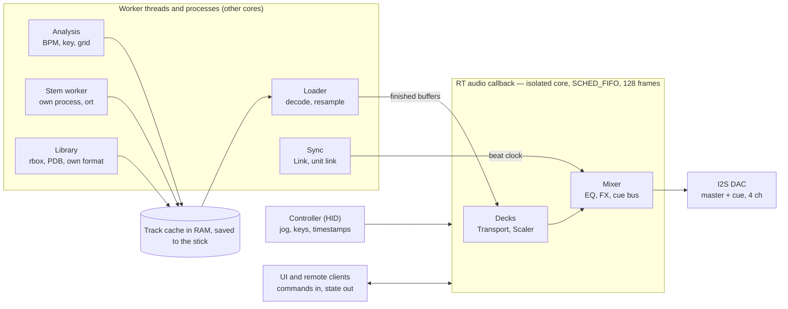

# DJ Player Engine – Research

Exported 2026-10-20 from the living doc: https://claude.ai/code/artifact/271c7e09-9192-49d3-bcdb-abe21dd9447d — the doc is the source of truth; re-export when it changes.

## Summary

Build the engine as one Rust library (`engine-core`) with a single real-time audio callback that owns every deck, and wrap it in a thin daemon (`engined`) for the standalone and all-in-one configurations. In PC mode the same library runs in-process. Everything slow — decoding, analysis, stem separation, library and network — runs on worker threads and hands finished buffers to the callback through lock-free queues.

- **Audio I/O:** cpal on ALSA directly (no PipeWire) on the Pi, 48 kHz, 128-frame periods, on a PREEMPT\_RT kernel. That gives a 2.67 ms callback budget and single-digit-ms output latency.
- **Decks:** decode the whole track into RAM ahead of playback. Seeks, hot cues, reverse and scratching then never wait on disk or decoder.
- **Rate:** two paths. A variable-rate interpolating resampler for pitch fader without keylock and for all scratching; a time-stretcher for keylock behind a trait, starting with Signalsmith Stretch (MIT) and benchmarking Rubber Band and Bungee against it.
- **Sync:** an internal beat clock per engine, beatgrids from the Rekordbox ANLZ files (rbox) or own analysis, Ableton Link via rusty\_link.
- **Stems:** play NI `.stem.mp4` and a native multi-track format; separate on a PC or overnight on the device, since HTDemucs on the Pi 5 CPU is roughly 3× slower than real time.
- **License:** plan for GPL-3.0-or-later. rbox is GPL-3.0-only, and Rubber Band and Ableton Link are GPL too, which fits an open-source project.

## Process and threads

One `engined` process per host. The callback is the only real-time thread; the loader, analysis, library and sync run as normal threads on the other cores, stem separation runs as its own process, and a collector thread frees retired buffers so the callback never has to.

## Audio I/O

Use cpal behind a small `AudioBackend` trait, open the ALSA `hw:` device directly on the Pi, and run one 4-channel stream for master plus headphone cue. One stream means one clock, so master and cue can never drift apart.

**Backend.** [cpal](https://github.com/RustAudio/cpal) covers ALSA, JACK and PipeWire on Linux, plus WASAPI/ASIO on Windows and CoreAudio on macOS, so PC mode gets the same engine for free. Smaller fixed buffers lower latency but raise CPU load and glitch risk, and cpal lets you request a fixed size. Keep the trait thin so a hand-written ALSA mmap backend can replace cpal later if the measured latency demands it.

**Skip PipeWire on the device.** Raspberry Pi OS runs PipeWire above ALSA by default ([Pi I2S white paper](https://pip-assets.raspberrypi.com/categories/1259-audio-camera-and-display/documents/RP-009699-WP-1-Using%20the%20I2S%20peripherals%20on%20Raspberry%20Pi%20SBCs.pdf)). On the standalone player, disable it and open the DAC exclusively. On desktop, use whatever host API the OS prefers.

**Kernel.** PREEMPT\_RT has been in mainline Linux since 6.12 for ARM64, and Pi 5 support landed in the same release ([Phoronix](https://phoronix.com/review/linux-612-features)). Build an RT kernel for the CM5 image, pin the audio thread to an isolated core with SCHED\_FIFO, and keep the UI and workers on the other three. An AES study on a Pi 4 found Xenomai/Elk Audio OS beats PREEMPT\_RT on latency, but PREEMPT\_RT still performs well and is far easier to maintain ([AES](https://aes2.org/publications/elibrary-page/?id=21553)).

**Starting point.** 48 kHz, 128-frame periods, 2–3 periods. 128 frames at 48 kHz is 2.67 ms per callback; keep engine work under half of that so spikes have headroom. Try 64 frames once the spike shows clean callback-time histograms.

**Master + cue on one device.** On Pi 5 and CM5, the RP1 I2S0 peripheral has four data lanes, and the HiFiBerry DAC8x already uses all four as one 8-channel ALSA device. TDM and MCLK are not supported on any Pi, so pick DACs that run from BCLK or a local oscillator (PCM5122-class with PLL) ([Pi I2S white paper](https://pip-assets.raspberrypi.com/categories/1259-audio-camera-and-display/documents/RP-009699-WP-1-Using%20the%20I2S%20peripherals%20on%20Raspberry%20Pi%20SBCs.pdf)). For the carrier board, that means two stereo DACs on SDO0 and SDO1 sharing BCLK/LRCK, exposed to the engine as one 4-channel device.

Open question: whether a custom overlay can reuse the DAC8x path for a 4-channel (two-lane) card, or needs its own driver entry in `rpi-simple-soundcard`.

## Real-time rules

The audio callback never allocates, frees, locks, logs, or touches the filesystem or network. Enforce that in code, not by review.

| Rule | How to enforce it |
| --- | --- |
| No allocation or deallocation in the callback | Wrap the callback in [assert\_no\_alloc](https://github.com/Marcono1234/rust-assert-no-alloc) in debug and CI builds; it aborts or warns on any (de)allocation in that scope |
| No frees on the audio thread | Hand retired buffers (an old track, a replaced stretcher) back to a collector thread, e.g. basedrop, instead of dropping them in the callback |
| No locks | Commands in through a bounded SPSC ring (rtrb); state out through atomics, a triple buffer, or a seqlock'd shared-memory block |
| Fixed work per callback | Preallocate stretcher, resampler and FX state at deck load, sized for the worst case (max rate, max block) |
| Bounded command handling | Drain at most N commands per callback; a command that needs heavy work (load, analyze) only swaps a pointer to something a worker already built |

The same pattern is used in Rust audio hosts today: MIDI events pushed onto a lock-free queue, real-time safety tested with assert\_no\_alloc, and basedrop to keep deallocation off the audio thread ([audio-processor-standalone-midi](https://docs.rs/audio-processor-standalone-midi/)).

FFI libraries (Signalsmith, Rubber Band, Bungee, Link) are C++: confirm each one's real-time path is allocation-free in the configuration you use, under assert\_no\_alloc, before trusting it.

## Deck pipeline

Decode the whole track into RAM on a worker thread, chunk by chunk, and let playback start as soon as the chunks around the playhead and the hot cues are ready. A fully resident track makes seeks, hot cues, loops, reverse and scratching free, and removes Mixxx-style read-ahead logic from the hot path.

**Decoding.** [Symphonia](https://github.com/pdeljanov/symphonia) is pure safe Rust, covers MP3, AAC-LC, ALAC, FLAC, WAV/AIFF and MP4 containers, and its decoders run within about ±15% of FFmpeg. It is MPL-2.0. Keep an optional FFmpeg backend behind the same `Decoder` trait for odd files. Resample to 48 kHz once at load time with [rubato](https://docs.rs/crate/rubato/latest), so the playback path only ever sees engine-rate audio.

**Memory per deck** (48 kHz stereo, 6-minute track):

| Content | f32 | i16 |
| --- | --- | --- |
| Stereo mix | 138 MB | 69 MB |
| 4 stereo stems | 553 MB | 276 MB |

On an 8 GB CM5 two stem decks fit in f32; four stem decks in the all-in-one mode want i16 storage, converted to f32 per block. Keep the format a per-deck choice.

**Lesson from Mixxx.** In Mixxx, one class (`EngineBuffer`) reads decoded audio, tracks play state, rate and direction, answers seek/hotcue/loop requests, and resamples; Mixxx's own developer guide calls it the most complicated part of the codebase ([Mixxx dev guide](https://github.com/Holzhaus/mixxx/wiki/Developer-Guide-Engine-Player)). Split those jobs from the start:

- `Source`: the resident sample store, with per-chunk ready flags
- `Transport`: position, rate, direction, loop and cue state — pure logic, unit-testable without audio
- `Scaler`: turns a transport segment into output samples (resampler or stretcher)
- `DeckFx`: EQ, filter, stem gains

**Gapless and edge cases.** Use the decoder's gapless info (Symphonia lists gapless support for MP3, FLAC and ALAC, not AAC) so the beatgrid from Rekordbox lines up with your decoded sample 0. Validate early on a set of Rekordbox-analysed MP3s: an encoder-delay offset shows up as every cue being a few ms late.

## Rate, scratching and keylock

Give every deck two scalers and let the transport pick per block: an interpolating resampler for pitch-fader play without keylock and for every scratch, and a time-stretcher for keylock and key shift. Crossfade between them over a few milliseconds when the mode changes.

**Resampler path (write it yourself).** Read the resident buffer at fractional positions, so negative, zero and extreme rates all work — that is what reverse, brake and scratch need. Use cubic Hermite while the platter is touched (cheap, fine for scratch) and a short windowed-sinc kernel for normal play above 1.0× to avoid aliasing. Mixxx keeps a linear scaler and only uses it when the rate change is under one cent ([Mixxx EngineBuffer](https://github.com/mixxxdj/mixxx/blob/752b3cc3f64c3597b78a5818b3533a1ec82d5f26/src/engine/enginebuffer.cpp)). Rubato is for load-time sample-rate conversion, not this: it processes a stream in chunks, not random-access reads in reverse.

**Keylock path (behind a `Stretcher` trait).** Three candidates, benchmarked on the Pi in the keylock spike:

| Library | License | Latency / CPU | Fit |
| --- | --- | --- | --- |
| [Signalsmith Stretch](https://github.com/Signalsmith-Audio/signalsmith-stretch) | MIT | Default and cheaper presets; exposes input and output latency; `seek()` for jumps | Start here. Rust wrappers exist ([signalsmith-stretch](https://docs.rs/signalsmith-stretch), [ssstretch](https://lib.rs/crates/ssstretch)) |
| [Bungee](https://github.com/bungee-audio-stretch/bungee) | MPL-2.0 | About 20 ms for speed/pitch changes, 40 ms input to output ([JUCE forum](https://forum.juce.com/t/looking-for-a-timestretching-pitchshifting-library-that-has-very-low-latency/45404)) | Its granular API allows any playhead movement, including reverse and scratch, so it may remove the scaler switch. Rust: [bungee-rs](https://rust-digger.code-maven.com/crates/bungee-rs) |
| [Rubber Band](https://github.com/arthenica/rubberband) | GPL or commercial | R2 is cheap; R3 sounds better at much higher CPU; R3 short-window mode cuts CPU and delay | What Mixxx ships. No maintained Rust crate checked; bind via bindgen |

**Latency compensation.** A stretcher outputs audio tens of ms behind its input. The transport must offset the reported playhead by the stretcher's output latency, or waveforms, beat sync and quantized cues drift by that amount whenever keylock is on.

**Platter to audio.** The RP2040 sends timestamped encoder counts and the touch flag at \~1 kHz. The engine estimates platter angle at each callback start, maps it to a target track position, and steers playback toward it with a small tracking filter, so the sound follows the hand within a callback or two without zipper noise. xwax does the same job from timecode vinyl and is the reference for how that feel should behave ([xwax](https://www.mankier.com/package/xwax)). When the platter is released, apply a configurable spin-up; on stop, a configurable brake.

**Scratch with keylock on.** Switch to the resampler path on touch, then crossfade back into the stretcher on release after priming it with `seek()` at the new position. If Bungee handles scratch directly at acceptable CPU, drop the switch.

## Sync and beatgrid

Run one `BeatClock` per engine instance, measured in beats against the audio sample clock, and make every deck either the clock's leader or a follower. Link, Pro DJ Link and your own unit-to-unit protocol are then just adapters that feed or read that clock.

- **Beatgrid source, in order:** the Rekordbox ANLZ beatgrid from the USB stick (rbox reads all three ANLZ formats), then your own on-device analysis, then a manual tap/shift. Store grids as a list of (sample position, beat number, bar position) so variable-tempo tracks work.
- **Follower control:** a follower's rate = leader tempo ÷ track tempo, plus a small phase correction that converges over a bar or two. Apply it through the transport, so it is the same code path as the pitch fader.
- **Quantize:** cues, loops and hot cues snap to the nearest grid line, using the latency-compensated playhead from the keylock section.
- **Ableton Link:** [rusty\_link](https://docs.rs/crate/rusty_link/latest) wraps Ableton's official C API and includes a port of HostTimeFilter, which aligns the host clock with the sample clock inside the audio callback. Run Ableton's Link test plan before calling it done. Link is GPLv2+ or proprietary, and so is the wrapper.
- **Unit-to-unit linking:** start with your own open protocol over Ethernet (beat clock + library browsing), with Link alongside for tempo. Pro DJ Link presence via the Deep Symmetry work stays a stretch goal, as suggested in the earlier session.

## Mixer, EQ and FX

Keep the mixer in the same callback as the decks and make it optional per configuration: the standalone player outputs one deck's post-fader signal, the all-in-one sums 2–4 channels plus a cue bus.

- **Per channel:** trim, 3-band EQ (isolator-style crossovers, Linkwitz-Riley 4th order, so kills are clean), one-knob HPF/LPF filter, fader, cue send. Write these as plain biquad/SVF structs; they are small, and owning them keeps them allocation-free.
- **Stems:** per-stem gain and mute ahead of the channel EQ, with short gain ramps so mutes don't click.
- **Beat FX:** delay, echo, reverb, roll, flanger, tempo-synced from the `BeatClock`. Delay lines are preallocated for the longest note value at the slowest supported tempo.
- **Master:** a true-peak-aware limiter on the master bus, since a DJ unit gets pushed into the red.

Whole-graph libraries such as fundsp are worth a look for FX prototyping, but the core mixer should stay hand-written so its cost per block is known.

## Stems

Treat stems as precomputed assets: play NI `.stem.mp4` files for interop, generate your own into a content-hashed cache, and run separation as a background job that never competes with playback.

**Playback formats.**

- **NI Stems:** an MP4 container holding the stereo master plus four AAC stems, with stem names and colours in custom atoms ([djworx](https://djworx.com/native-instruments-stems-some-clarification/), [ISMIR 2015 paper](https://www.ismir2015.uma.es/LBD/LBD39.pdf)). Mixxx 2.6 plays them; its 2024 announcement said it didn't yet apply NI's embedded mastering or generate stems itself ([Mixxx blog](https://mixxx.org/news/2024-08-26-STEM-Mixing)). Check in the deck spike that Symphonia's MP4 demuxer exposes all five audio tracks.
- **Own cache:** stems stored next to the library, keyed by a hash of the decoded audio, as FLAC or raw i16 for fast loading. The open-source finyl player does the same on Rekordbox USB sticks, matching stem files by the original file's MD5 ([finyl](https://github.com/0xsuk/finyl)).

**Separation speed.** HTDemucs (MIT) is the default model. Measured numbers so far:

| Hardware | Runtime | Time |
| --- | --- | --- |
| Raspberry Pi 5 | PyTorch CPU | \~23 s per 7.8 s segment ([Go port PR](https://github.com/kurz-infrastructure/demucs/pull/1)) |
| Raspberry Pi 5 | pure Go port | 44.6 s per 7.8 s segment ([same PR](https://github.com/kurz-infrastructure/demucs/pull/1)) |
| Apple M4 Pro | ONNX Runtime CPU, single-stem specialist | \~22 s per 3-min song ([StemSplit](https://github.com/StemSplit/demucs-onnx)) |
| Apple M4 Pro | ONNX Runtime CPU, full 4-model bag | \~88 s per 3-min song ([StemSplit](https://github.com/StemSplit/demucs-onnx)) |

From the PyTorch figure, a 3-minute track on the Pi 5 is about 23 segments × 23 s ≈ 9 minutes, before overlap. That works as a background job that writes its result to the stick, not at load time. The model itself (hundreds of MB) has to fit in RAM next to the loaded decks, and stems should be stored compressed (FLAC or AAC), since a 6-minute track's four stems are \~276 MB even as raw i16 and USB sticks write slowly.

**Runtime.** Run the ONNX exports of HTDemucs through the [ort](https://docs.rs/crate/ort/latest) crate (ONNX Runtime, with an XNNPACK provider for ARM), in a separate low-priority process so a crash or memory spike can't touch the audio thread. Ship a small PC companion that runs the same code with a GPU provider and writes into the same cache.

**CPU at playback.** Four stems per deck means four streams through the scaler. With keylock on, either stretch each stem (4× cost) or sum stems after gains and stretch once. Summing first costs one stretcher instead of four; compare the two by ear in the keylock spike and default to summing unless it audibly smears transients.

## On-device analysis

Prefer Rekordbox's own analysis when the stick carries it, and run your own analysis only for tracks without it, as a niced background queue that pauses while a deck is playing near its CPU budget.

| Task | First choice | Notes |
| --- | --- | --- |
| Rekordbox data | [rbox](https://docs.rs/crate/rbox/latest) | Reads OneLibrary `exportLibrary.db`, `master.db`, XML and all three ANLZ files (waveforms, beatgrid, cues) |
| BPM, key, beatgrid | [stratum-dsp](https://docs.rs/crate/stratum-dsp/latest) | Pure Rust, MIT/Apache. Self-reported 87.7% within ±2 BPM on 155 DJ tracks, against 98.1% for Mixed In Key on the same set. Promising, not yet good enough alone |
| Higher-accuracy fallback | [Essentia](https://essentia.upf.edu/licensing_information.html) | C++, AGPL-3.0 (fine here). Its pretrained models are CC BY-NC-ND, so use only the classic DSP algorithms |
| Waveform overview + 3-band detail | Own code | Computed during decode, one pass, stored with the track cache; the UI uploads it to the GPU once |
| Loudness | Own code (EBU R128) | Auto-gain on load |

Build a small ground-truth set early (100–200 tracks with Rekordbox grids and keys) and score every analyser against it. The stratum-dsp numbers come from its own README, so treat them as a claim to verify.

Open question: rbox's README lists OneLibrary, `master.db`, XML and ANLZ but not the legacy `export.pdb`. Older sticks need a PDB reader; finyl parses it from a Kaitai Struct spec, which could be ported or generated into Rust.

## Engine API

Expose the engine through three channels, all defined once in the `protocol` crate, and let the controller talk to the engine directly rather than through the UI.

| Channel | Carries | Local transport | Remote transport |
| --- | --- | --- | --- |
| Commands | Typed `Command` enum: load, play, cue, hot cue n, jog (delta, touch, timestamp), rate, sync, loop, mixer, FX | In-process SPSC ring (PC mode) or Unix socket | WebSocket or QUIC |
| Fast state | Playhead, rate, beat phase, meters per deck, written every callback | Seqlock'd shared-memory block | Timestamped frames at 60 Hz |
| Slow state | Snapshot + diffs: track loaded, analysis done, cue list, library changes | Unix socket | WebSocket or QUIC |

- **Timestamps on everything.** Commands carry host time; the engine places them at the right sample in the next callback, and quantize then snaps them to the grid.
- **Controller path.** The RP2040 board speaks a timestamped HID protocol to `engined`, so jog latency is bounded by the engine, not by UI frame timing. A class-compliant MIDI mode stays available for using the hardware with other software. The link is two-way: the engine sends feedback reports back to the board for pad RGB colours, key LEDs and the GC9A01 jog display (position indicator, cue/slip marker, touch and VINYL state).
- **Mapping lives in the engine,** as a data file (control id → command), not in firmware. The same board then works as standalone surface, all-in-one surface or PC controller.
- **The UI is a client like any other.** It never owns state; it renders the latest fast-state frame and interpolates the playhead between frames, as planned in the wgpu UI session.

## Parity requirements the engine must cover

Checked against the [XDJ reference spec](https://claude.ai/code/artifact/29b73515-7daf-401f-aa8d-1b8cad02e09f) and the project findings, the engine design didn't yet cover eight behaviours. The two with architectural weight are slip mode, which needs a second playhead in `Transport`, and write-back to the stick, which needs crash-safe writes.

| Requirement | Reference behaviour | Engine impact |
| --- | --- | --- |
| Slip mode | Background playhead keeps running through vinyl pause, scratch, loops, hot cue hold (auto-ends after 4 beats), reverse (after 8 beats), loop move; slip loops max 8 s | `Transport` carries a shadow position advancing at the real rate; every action that moves the playhead declares whether it is slip-able and its auto-end rule. Loop roll is just loop + slip |
| Write-back to USB | History (track logged after \~1 min of play), tag list, ratings, memory cues and hot cues saved to the stick; safe eject by USB STOP | A `library` writer behind a queue; written only to our own library on the stick (next section), never to the Rekordbox files. Engine emits play-time events for history |
| Keep playing without the stick | The reference keeps an emergency loop if the read fails | Free with a fully resident track: pulling the stick only blocks loading and writes. Expose per-chunk "loaded" state in fast state for the cache meter and jog display |
| Tempo ranges | ±6 % in 0.02 % steps, ±10 % and ±16 % in 0.05 %, WIDE ±100 % in 0.5 % | Fader value quantized to the range's step with hysteresis in the engine, not the firmware. WIDE means rates near 0 and up to 2× with keylock: test stretchers at the extremes, not only near 1.0 |
| Reverse with keylock | DIRECTION REV, slip reverse | Signalsmith and Rubber Band only run forward. Reverse uses the resampler path (no keylock) unless Bungee handles it |
| Cue details | Back cue, cue sampler, real-time cue, 0.5-frame (\~6.7 ms) fine adjust, auto cue skipping silence at −36 to −78 dB or first memory cue, hot cue auto load | Transport commands with sample-accurate targets; analysis adds a first-audible-sample per threshold; load sequence applies auto cue and hot cue auto load |
| Sync extras | INST.D. instant double jumps to the master's position; pitch bend breaks sync; phase meter shows bar and beat offset | `BeatClock` exposes bar phase per deck; jog nudge drops follower mode |
| Jog scale | One platter turn = 1.8 s of audio (scratch, frame search, centre display) | Fixed counts-per-1.8 s constant in the platter mapping; the GC9A01 indicator uses the same constant |

**3-band waveforms from Rekordbox.** rbox reads all three ANLZ files, including the extended ones that carry colour waveforms. Use those when present and compute your own only for unanalysed tracks.

## Own library on the stick

Rekordbox data is read-only: we never modify `export.pdb`, `exportLibrary.db` or ANLZ files, so a stick keeps working in Rekordbox and on CDJs. Everything our player creates or changes goes into our own library, in its own folder at the root of the same stick.

**What it holds.** Our own library takes all the writes:

- history and play counts
- tag lists, ratings and colours
- memory cues, loops and our 16 hot cues
- beatgrid edits
- on-device analysis and 3-band waveforms
- stem references
- per-stick settings (our MY SETTINGS equivalent)

It works on its own too, so a stick with no Rekordbox export at all (folder mode) gets the full feature set.

**Overlay model.** For each field, the effective value is ours if we have one, else Rekordbox's. Cues are the exception and switch per track: once a DJ edits cues on our player, our set wins for that track, with a "revert to Rekordbox cues" action. Re-exporting from Rekordbox never conflicts, because we never wrote there.

**Track identity.** Rekordbox track IDs can change between exports, so don't key on them. Key on the file's relative path plus a hash of its decoded audio (computed once during analysis), and keep a per-export map to Rekordbox IDs as a cache. A moved or renamed file is then re-matched by hash.

**Storage (proposal).**

- **Log-structured, not a database file.** On disk the library is a snapshot plus one append-only journal per device (`journal/<device-id>/<seq>.log`). A device only ever creates new files in its own journal folder, so two players, a laptop and a cloud copy can never overwrite each other's writes, and a yanked stick loses at most the segment being written.
- **Deterministic merge.** On mount, every journal is replayed in timestamp order (hybrid logical clocks) into an in-RAM index (SQLite in memory, or plain structs). Fields merge last-writer-wins; history and play counts are append-only sets. Occasionally a device folds the journals into a new snapshot.
- **Large data** (waveforms, analysis frames, stems) as separate content-addressed files under the same folder, written once and never modified.
- **Same format on every backend.** The USB stick and the cloud library store exactly the same files, so a stick can be a byte-for-byte offline copy of a cloud library. A schema version and a published spec keep the format open.

This replaces the earlier single-SQLite-file idea: a database file can't safely be edited from two places at once, and the cloud library makes that the normal case.

**Journal size and compaction.** Journals stay small because they only hold edits; analysis, waveforms and stems live in the content-addressed blob files. Rough estimate: a journal entry is \~100–200 bytes, a busy gig is \~30 tracks plus a few hundred cue and tag edits, so \~50 KB per gig, or a few MB per device per year of weekly gigs. What would actually grow is the number of files and the replay time on mount, so:

- **Rotate segments by session,** not by event: one segment per mount, plus a new one every \~64 KB. That's a handful of files per gig.
- **Snapshot with a version vector.** A snapshot records, per device, the highest journal sequence it includes. Any device can write one when the replay count gets large (e.g. more than \~50 segments).
- **Delete only what's covered.** Segments at or below a device's sequence in the snapshot's vector are safe to delete. A player that was offline and comes back later appends higher sequence numbers, so nothing it wrote is lost.
- **Concurrent snapshots are fine.** If two devices snapshot at once, load both, merge them (same merge rules), and delete the one whose vector is dominated.
- **Tombstones** for deleted cues and tracks stay in snapshots for a grace period (e.g. 90 days), so a late journal can't resurrect them.
- **Blob garbage collection** removes blobs no record references any more. Stems are the real space consumer (hundreds of MB per track), so give them a visible size and a "remove stems" action.

**No internal storage by default.** The device has no NVMe, so the stick is the only persistent store and RAM is the working cache:

- On mount, read our library into RAM alongside the Rekordbox data; all reads during a set hit RAM.
- Keep decoded audio of recently loaded tracks in an LRU cache in RAM, sized to what's left after decks and models.
- Write back small records (history, cues, ratings) within seconds, and each analysis result as soon as its job finishes, so a power cut or a yanked stick loses at most the item in flight.
- If the stick is read-only or full, keep everything in RAM for the session and show it; nothing is lost until power-off.

An on-device library stays possible but is never the default: an optional storage build that uses the exact same library format, so the same code treats internal storage as just another mounted source.

## Track sources and streaming

Make "where a track comes from" a provider interface from day one, so streaming services slot in later without touching the engine. The USB stick (Rekordbox + our library), folder mode and, later, each streaming service are all providers behind the same two traits in a `sources` crate.

| Trait | Provides | Notes |
| --- | --- | --- |
| `CatalogProvider` | Browse tree, search, metadata, artwork, any cues/grids the source has, auth state | Async, on worker threads; the UI browses all providers the same way |
| `MediaProvider` | `open(track)` → byte stream with range or segment fetch, codec, duration, and a policy record | Policy flags: may cache audio, may cache analysis, may separate stems, offline locker size |

**Why the engine already fits.** Decks play from RAM chunks with per-chunk ready flags, so a track arriving over the network is just a slow load:

- The loader fetches chunks around the playhead, cue and hot cues first, and issues range requests for seeks.
- If the playhead reaches a chunk that isn't there, the deck holds an emergency loop and the UI shows the cache meter. The callback never waits on the network.
- Streamed containers (HLS/DASH segments carrying AAC or FLAC) are reassembled in the provider before Symphonia sees them.

**Identity and our library.** Track keys become URIs: `usb:<relative path>#<audio hash>` for files, `<provider>:<track id>` for services. Cues, grids, history and analysis for a streamed track live in our library on the stick under that URI, if the service's terms allow storing derived data. Audio itself is cached only where the policy allows it, such as an offline locker.

**Sign-in on the device.** Use the OAuth device-code flow: the screen shows a QR code and short code, the DJ approves on their phone, and nobody types a password on the touchscreen.

**Reality check.** DJ streaming is a partnership business, not an open API:

- Beatport's integration into Denon hardware, including offline storage on the device, came through a licensing partnership ([Music Business Worldwide](https://www.musicbusinessworldwide.com/beatport-integrates-link-subscription-service-with-denon-dj-hardware)).
- SoundCloud's API terms need explicit approval for commercial uses ([SoundCloud API discussion](https://github.com/soundcloud/api/discussions/566)).
- Spotify stopped playing in third-party DJ apps on 1 July 2020 ([djay on Microsoft Store](https://apps.microsoft.com/detail/9nblggh4vm4h?hl=zh-CN)).

So plan each service as a separate provider process speaking a documented protocol. Partner credentials, and any DRM decryption a service requires, then stay outside the open-source core. Check the GPL implications of that split before the first integration.

Open question: which service to target first, and whether any offers an integration path to a non-commercial open-source project.

## Cloud library (first non-USB source)

The first provider after USB is a cloud library: audio files in the DJ's Dropbox, plus our library data stored in a folder next to them. It reuses everything above; the cloud is just a slower, shared backend for the same files.

**What the Dropbox API gives us** ([file access guide](https://developers.dropbox.com/dbx-file-access-guide), [OAuth offline access](https://dropbox.tech/developers/using-oauth-2-0-with-offline-access)):

| Need | Dropbox feature | Use |
| --- | --- | --- |
| Start playback before the whole file arrives | `files/download` accepts HTTP `Range` and returns an ETag | Chunked, prioritised fetch around the playhead and cues, as in the streaming section |
| Know if a file changed without downloading it | Every file's metadata carries a `content_hash` you can recompute locally | Track identity and change detection |
| Notice changes from the laptop | `list_folder` cursors plus `list_folder/longpoll` (responses can lag by up to 90 s of jitter) | Pick up new tracks and other devices' journal segments |
| Stay signed in | Offline access returns a refresh token that doesn't expire until revoked; PKCE works without an app secret | Refresh token stored on the device's boot storage, never on the stick |

**Identity.** Use Dropbox's `content_hash` algorithm as the file hash everywhere, computed locally for USB files too. Then the same track on a stick and in Dropbox matches without downloading it. Keep the decoded-audio hash as a fallback key, since a tag edit changes the file bytes but not the audio.

**Sign-in on the device.** Dropbox's OAuth needs the user to approve in a browser; I found no device-code flow. Show a QR code for the PKCE authorise URL; the DJ approves on their phone and types the authorisation code Dropbox shows into the on-screen keyboard. A desktop companion can do the same sign-in and hand the token over on the local network.

**Offline at the gig.** Club Wi-Fi can't be trusted. Offer "prepare for gig": sync selected playlists (audio + library data) onto a USB stick. Because the formats are identical, that stick then plays offline like any other, and its journal syncs back to the cloud on the next connection. During online play, prefetch the next tracks of the current playlist or tag list into RAM.

**Analysis once, everywhere.** Analysis, grids, waveforms and stems written to the cloud library are shared by every device, so a desktop companion can analyse and separate a whole collection overnight and the player just downloads the results.

Later backends (Google Drive, OneDrive, WebDAV, S3) only need range reads, file listing with change detection, and create-only writes, so the provider trait should ask for exactly those.

## Licensing

License the engine GPL-3.0-or-later. rbox is GPL-3.0-only, so any build that links it must be GPLv3, and every other dependency below is compatible with that.

| Component | License | Constraint |
| --- | --- | --- |
| [rbox](https://docs.rs/crate/rbox/latest) | GPL-3.0-only (earlier 0.1.x releases were MIT/Apache) | Forces GPLv3 for the engine binary |
| [Rubber Band](https://github.com/arthenica/rubberband) | GPL-2.0-or-later or commercial | Optional backend |
| [Ableton Link](https://docs.rs/crate/rusty_link/latest) / rusty\_link | GPLv2+ or proprietary | Optional feature |
| [Essentia](https://essentia.upf.edu/licensing_information.html) | AGPL-3.0; models CC BY-NC-ND 4.0 | Algorithms only, no models |
| [Symphonia](https://github.com/pdeljanov/symphonia) | MPL-2.0 | None |
| [Bungee](https://github.com/bungee-audio-stretch/bungee) / bungee-rs | MPL-2.0 | None |
| [Signalsmith Stretch](https://github.com/Signalsmith-Audio/signalsmith-stretch) | MIT | None |
| [stratum-dsp](https://docs.rs/crate/stratum-dsp/latest) | MIT or Apache-2.0 | None |
| [cpal](https://metadata.ftp-master.debian.org/changelogs/main/r/rust-cpal/testing_copyright) | Apache-2.0 | None |
| [HTDemucs ONNX](https://huggingface.co/StemSplitio/htdemucs-ft-onnx) | MIT | None |

The Rekordbox decryption key that rbox uses is community-extracted, as noted in the earlier session; keep a note in the README.

**Non-commercial DIY changes less than it seems** (not legal advice):

| Constraint | Does non-commercial help? |
| --- | --- |
| GPL / MPL / MIT dependencies | Not needed: we're GPL anyway, and the obligations apply to the project publishing the code, paid or not |
| Essentia models (CC BY-NC-ND) | Partly: non-commercial use is allowed, but NC terms don't mix cleanly with GPL redistribution. Make them an optional user download, not bundled |
| Rekordbox decryption key | No: this rests on interoperability, which doesn't depend on commercial status |
| Streaming APIs (Beatport, TIDAL, SoundCloud) | No: access is by contract and partner keys. A non-commercial project can apply, but can't skip the approval |
| DRM on streams | No: circumventing it is prohibited in the EU, Switzerland and the US whatever the purpose. A provider can only use the service's own sanctioned playback path |
| Dropbox | Not needed: the DJ's own files through the public API. Use a bring-your-own app key option so no shared secret ships in the repo |

## Crates, budget and spikes

Split the engine into crates so that `engine-core` has no I/O and no threads. It can then render a whole set to a WAV file in a unit test, which is how sync, quantize and scratch behaviour get regression-tested.

| Crate | Holds |
| --- | --- |
| `engine-core` | Source, Transport, Scaler, mixer, FX, BeatClock; pure and deterministic |
| `engine-stretch` | `Stretcher` trait; Signalsmith, Bungee, Rubber Band behind features |
| `engine-io` | `AudioBackend` trait; cpal implementation |
| `engine-media` | Symphonia decoding, load-time resample, track cache, waveform data |
| `engine-analysis` | BPM, key, grid, loudness wrappers and the ground-truth scorer |
| `engine-stems` | Separation worker (ort); runs as its own process |
| `engine-sync` | Link adapter and the unit-to-unit protocol |
| `library` | Read-only Rekordbox reader (rbox + legacy PDB) and our own library store |
| `protocol` | Commands, fast-state layout, events (shared with `ui` and `controller-fw`) |
| `engined` | The daemon binary that wires it all together |

**Callback budget.** At 128 frames and 48 kHz each callback has 2.67 ms; aim to use at most half, about 1.3 ms, for decks + mixer. How many keylocked stem decks fit in that on a Pi 5 is the main unknown; the spikes answer it.

**Spikes, in order:**

1. **Audio path:** RT kernel + cpal on ALSA `hw:` with an I2S DAC, two decoded decks playing, UI load on the other cores. Log a callback-time histogram and xruns for an hour. Pass: zero xruns at 128 frames.
2. **Keylock shootout:** Signalsmith (default, cheaper), Bungee, Rubber Band R2 and R3 short-window. Per-deck CPU at 0.92×, 1.0×, 1.08× and the WIDE extremes (0.1×, 2×); latency; blind A/B on ten club tracks; clean under assert\_no\_alloc.
3. **Platter loop:** RP2040 + encoder over HID into the engine. Measure hand-to-sound latency with a contact sensor and a mic on the output. Target under 10 ms.
4. **Rekordbox stick:** load from a real Rekordbox 7 export, play against the ANLZ beatgrid, and check cue offsets on MP3 and AAC files.
5. **Stems:** two decks × four stems with keylock on the Pi; NI `.stem.mp4` demux through Symphonia; HTDemucs via ort, wall time per track.

## Developing on macOS first

Start on the Mac, and keep the Pi measuring the budget from week one. An Apple Silicon Mac is several times faster than a Pi 5, so a design that only runs on the Mac will hide CPU problems until the port.

**What carries over unchanged.** `engine-core`, the stretchers, Symphonia, rubato, rbox, stratum-dsp and Link build the same on both. Both machines are ARM64, so SIMD paths in C++ libraries (NEON) are exercised on the Mac too. The `AudioBackend` trait already isolates the one OS-specific layer.

**What differs on the Mac:**

| Area | macOS | Pi target | What to do |
| --- | --- | --- | --- |
| Audio backend | cpal on CoreAudio; the callback already runs on a real-time thread | cpal on ALSA `hw:`, PREEMPT\_RT, SCHED\_FIFO set by you | Keep all priority and core-pinning code behind the backend trait |
| Sample rate | Set by the device (often 44.1 or 48 kHz) | Fixed 48 kHz | Never hard-code 48 kHz; resample at load to whatever the device runs |
| Master + cue | A USB interface with ≥ 4 outputs; avoid aggregate devices, whose drift correction adds latency | One 4-channel I2S device | Same 4-channel stream layout on both |
| Controller | HID via hidapi; use a vendor-defined usage page so macOS doesn't treat the board as a keyboard | HID via hidraw | Same protocol and mapping file |
| Stems | ONNX Runtime with the CoreML provider is fast | CPU only, slow | Never let Mac stem speed shape the UX; keep stems an offline job |
| Build | Native cargo | Cross-compile to `aarch64-unknown-linux-gnu` (cargo-zigbuild or cross); cpal needs ALSA headers in the sysroot | Set up the cross build in the first week, not at port time |

**Keeping the Pi honest.**

- **Offline benchmark harness:** `engine-core` renders N decks to memory with no audio device (criterion benches), timing ns per frame per feature (scaler, stretcher, stems, EQ, FX). Run it on the Mac and on a Pi 5 in CI, and track the Pi number against the 1.3 ms callback budget.
- **Budget meter in the engine:** callback time ÷ buffer duration exposed in the fast state, so the UI shows load on both machines.
- **Run spikes 1 and 2 on a Pi early:** the audio-path and keylock spikes only mean something on the target. The others (platter, Rekordbox stick, stem demux) can start on the Mac.

**Revised spike order:** keylock shootout and Rekordbox stick on the Mac first (fast iteration), with the same benchmark run on a Pi 5; then the audio-path spike on the Pi once a DAC is wired; platter loop on whichever machine the RP2040 board is plugged into.

## Sources

- [Raspberry Pi – Using the I2S peripherals on Raspberry Pi SBCs (white paper, 2026)](https://pip-assets.raspberrypi.com/categories/1259-audio-camera-and-display/documents/RP-009699-WP-1-Using%20the%20I2S%20peripherals%20on%20Raspberry%20Pi%20SBCs.pdf)
- [Phoronix – Linux 6.12 features (PREEMPT\_RT, Pi 5)](https://phoronix.com/review/linux-612-features)
- [AES – PREEMPT\_RT vs Xenomai/Elk Audio OS on Raspberry Pi](https://aes2.org/publications/elibrary-page/?id=21553)
- [cpal on GitHub](https://github.com/RustAudio/cpal)
- [rust-assert-no-alloc](https://github.com/Marcono1234/rust-assert-no-alloc)
- [audio-processor-standalone-midi (lock-free queue, basedrop)](https://docs.rs/audio-processor-standalone-midi/)
- [Symphonia](https://github.com/pdeljanov/symphonia)
- [rubato](https://docs.rs/crate/rubato/latest)
- [Mixxx developer guide – engine player](https://github.com/Holzhaus/mixxx/wiki/Developer-Guide-Engine-Player)
- [Mixxx enginebuffer.cpp](https://github.com/mixxxdj/mixxx/blob/752b3cc3f64c3597b78a5818b3533a1ec82d5f26/src/engine/enginebuffer.cpp)
- [Signalsmith Stretch](https://github.com/Signalsmith-Audio/signalsmith-stretch)
- [ssstretch (Rust bindings)](https://lib.rs/crates/ssstretch)
- [Bungee](https://github.com/bungee-audio-stretch/bungee)
- [bungee-rs](https://rust-digger.code-maven.com/crates/bungee-rs)
- [JUCE forum – Bungee latency](https://forum.juce.com/t/looking-for-a-timestretching-pitchshifting-library-that-has-very-low-latency/45404)
- [Rubber Band Library README](https://github.com/arthenica/rubberband)
- [xwax](https://www.mankier.com/package/xwax)
- [rusty\_link](https://docs.rs/crate/rusty_link/latest)
- [rbox](https://docs.rs/crate/rbox/latest)
- [stratum-dsp](https://docs.rs/crate/stratum-dsp/latest)
- [Essentia licensing](https://essentia.upf.edu/licensing_information.html)
- [Mixxx – Stem mixing](https://mixxx.org/news/2024-08-26-STEM-Mixing)
- [djworx – NI Stems clarification](https://djworx.com/native-instruments-stems-some-clarification/)
- [ISMIR 2015 – Stem file format](https://www.ismir2015.uma.es/LBD/LBD39.pdf)
- [finyl – open-source Rekordbox-compatible stems DJ system](https://github.com/0xsuk/finyl)
- [Demucs Go port PR with Pi 5 timings](https://github.com/kurz-infrastructure/demucs/pull/1)
- [StemSplit demucs-onnx](https://github.com/StemSplit/demucs-onnx)
- [HTDemucs FT ONNX on Hugging Face](https://huggingface.co/StemSplitio/htdemucs-ft-onnx)
- [ort](https://docs.rs/crate/ort/latest)
- [Debian copyright file for cpal](https://metadata.ftp-master.debian.org/changelogs/main/r/rust-cpal/testing_copyright)

* [Music Business Worldwide – Beatport LINK in Denon DJ hardware](https://www.musicbusinessworldwide.com/beatport-integrates-link-subscription-service-with-denon-dj-hardware)
* [SoundCloud API – commercial use approval discussion](https://github.com/soundcloud/api/discussions/566)
* [djay Pro on Microsoft Store – Spotify note](https://apps.microsoft.com/detail/9nblggh4vm4h?hl=zh-CN)

- [Dropbox – file access guide (content\_hash)](https://developers.dropbox.com/dbx-file-access-guide)
- [Dropbox – OAuth 2.0 with offline access](https://dropbox.tech/developers/using-oauth-2-0-with-offline-access)
- [WebService::Dropbox – Range and ETag on files/download](https://metacpan.org/pod/release/ASKADNA/WebService-Dropbox-2.03/lib/WebService/Dropbox.pm)
